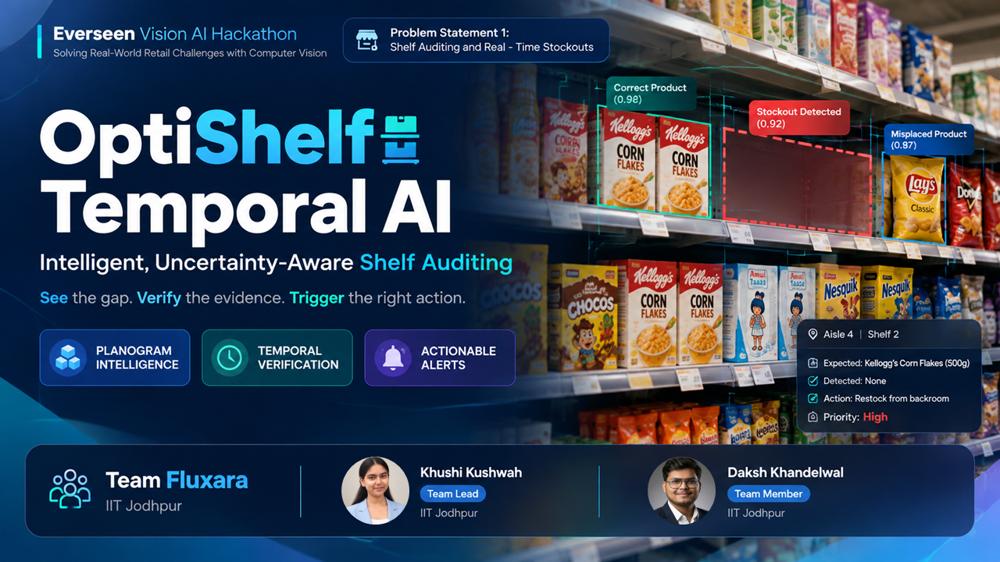
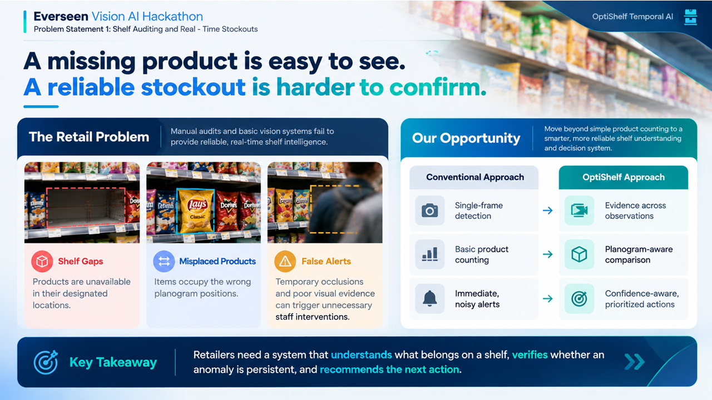
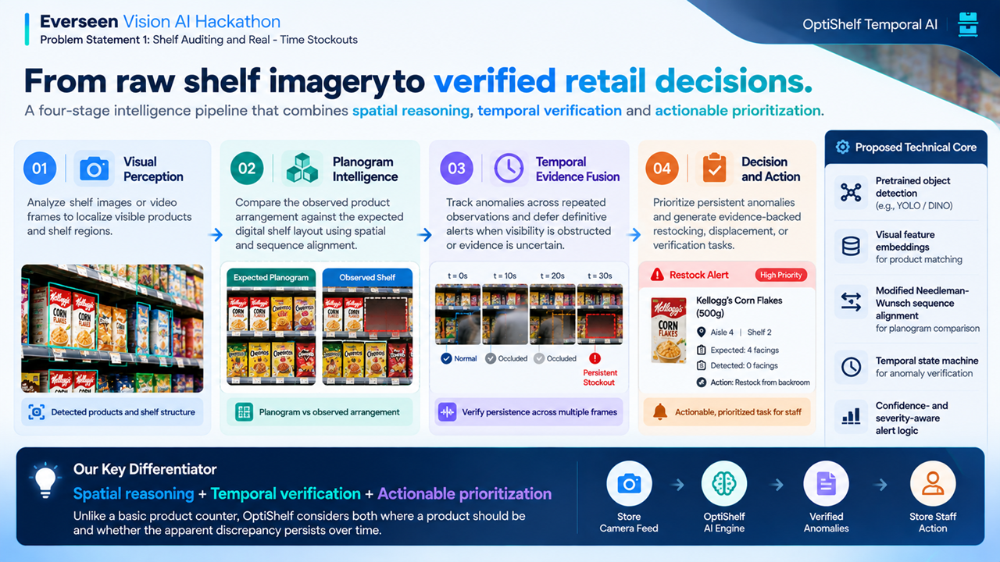
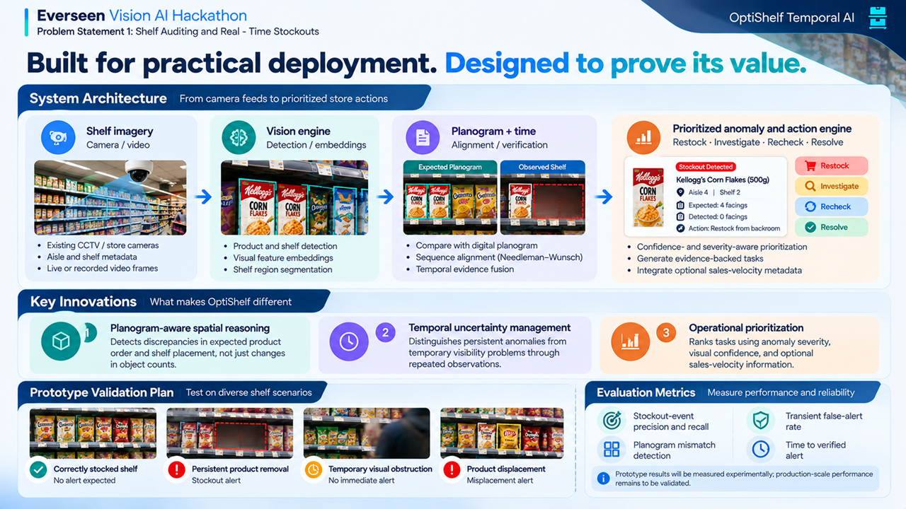
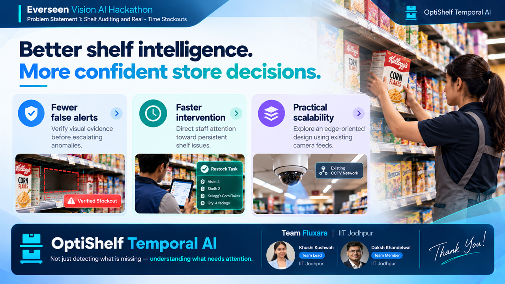

# 🛒 OptiShelf Temporal AI

### Intelligent, Uncertainty-Aware Shelf Auditing

**Everseen Vision AI Hackathon · Problem Statement 1**

*See the gap. Verify the evidence. Trigger the right action.*

---

## 📌 About the Project

**OptiShelf Temporal AI** is a proposed Vision AI solution for automated retail shelf auditing. It aims to detect stockouts and misplaced products by combining product detection, digital planogram comparison, and temporal verification.

Rather than relying on a single observation, the system evaluates anomalies across repeated observations and generates prioritized, evidence-backed recommendations for store staff.

## ✨ Key Features

- 🔍 **Visual Perception** — Analyze shelf imagery to identify products and shelf regions.
- 🧩 **Planogram Intelligence** — Compare observed product arrangements with expected shelf layouts.
- ⏱️ **Temporal Verification** — Distinguish persistent anomalies from temporary visual obstructions.
- 🚨 **Actionable Alerts** — Recommend restocking, investigation, rechecking, or resolution.
- 📊 **Confidence-Aware Decisions** — Prioritize anomalies using visual confidence, severity, and optional sales-velocity information.

## 🖼️ Pitch Deck Gallery

### Slide 1 — Introducing OptiShelf

*Product vision, hackathon overview, and Team Fluxara.*

### Slide 2 — The Retail Challenge

*Shelf gaps, misplaced products, false alerts, and the opportunity for smarter shelf intelligence.*

### Slide 3 — The Core Solution

*Four-stage intelligence pipeline: visual perception, planogram intelligence, temporal evidence fusion, and decision-making.*

### Slide 4 — Architecture & Validation

*System architecture, key innovations, prototype test scenarios, and evaluation metrics.*

### Slide 5 — Expected Impact

*Fewer false alerts, faster intervention, practical scalability, and the team's closing vision.*

## 🧠 Proposed Technical Approach

The proposed architecture combines:

- Pretrained object detection and visual feature embeddings.
- Planogram-aware spatial and sequence alignment.
- Temporal evidence fusion and anomaly verification.
- Confidence- and severity-aware prioritization.
- Action-oriented tasks for retail store staff.

These components represent the proposed design; implementation and performance require experimental validation.

## 📂 Project Deliverables

| File | Description |
|---|---|
| `Retail Vision AI Hackathon Plan.pdf` | Gemini Deep Research report and solution research |
| `OptiShelf_Temporal_AI_Fluxara.pptx` | Editable five-slide pitch deck |
| `OptiShelf_Temporal_AI_Fluxara.pdf` | Presentation in PDF format |
| `Slide1.PNG` – `Slide5.PNG` | Individual presentation slide images |

*Keep the filenames in this table synchronized with the files uploaded to the repository.*

## 👥 Meet Team Fluxara

<table>
  <tr>
    <td align="center" width="50%">
      <h3>Daksh Khandelwal</h3>
      📧 <a href="mailto:dk.khandelwaliitj@gmail.com">dk.khandelwaliitj@gmail.com</a> 
      🐙 <a href="https://github.com/dk-khandelwal06">GitHub</a> 
      💼 <a href="https://www.linkedin.com/in/daksh-khandelwal-b02748391/">LinkedIn</a>
    </td>
    <td align="center" width="50%">
      <h3>Khushi Kushwah</h3>
      📧 <a href="mailto:khushikushwah213@gmail.com">khushikushwah213@gmail.com</a> 
      🐙 <a href="https://github.com/khushikushwah213">GitHub</a> 
      💼 <a href="https://www.linkedin.com/in/khushi-kushwah-94420b421/">LinkedIn</a>
    </td>
  </tr>
</table>

## 🎯 Our Vision

Move beyond basic product counting toward **reliable, planogram-aware, evidence-based retail decisions**.

---

### Built for smarter retail. Designed for actionable intelligence.

**Team Fluxara | IIT Jodhpur**

*Everseen Vision AI Hackathon*

